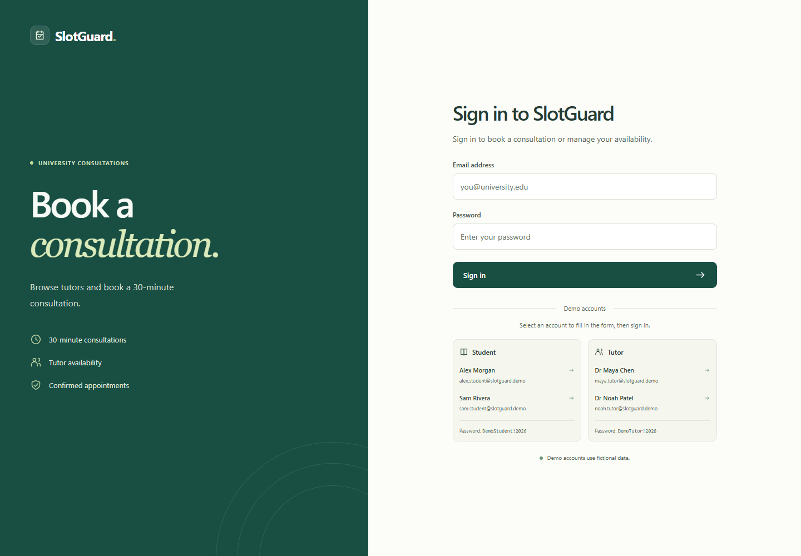
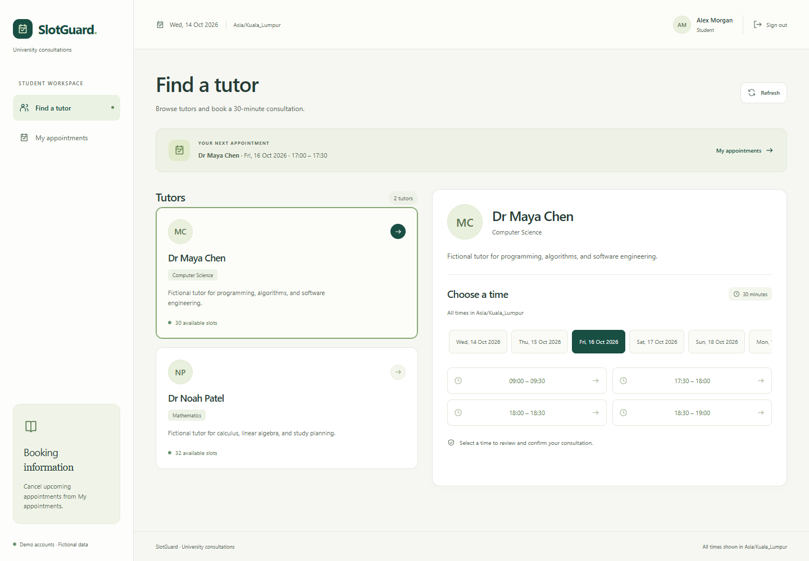
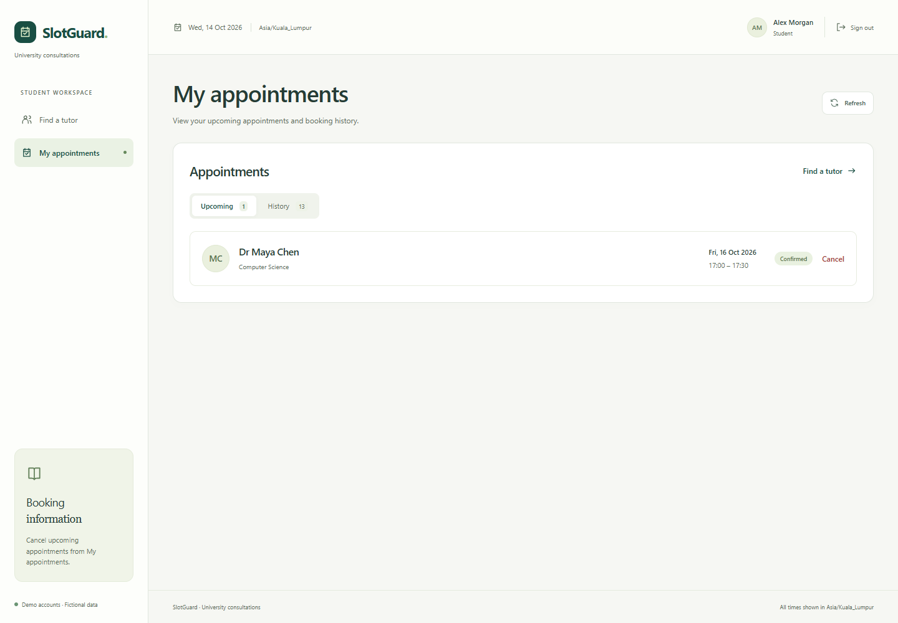
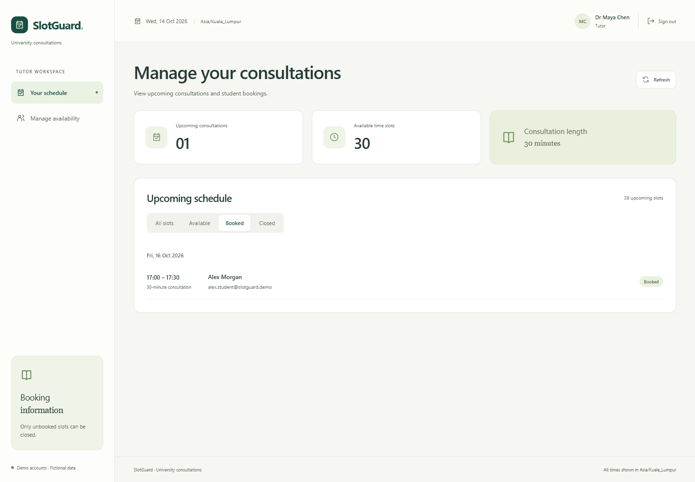
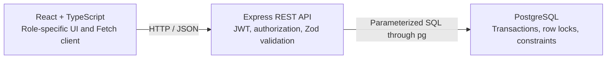

# SlotGuard

[](https://github.com/AyodhiaMassie/slot-guard/actions/workflows/ci.yml)

SlotGuard is a university consultation booking application. Students browse tutors, reserve 30-minute appointments, and manage cancellations. Tutors publish availability and see the students booked into their schedules.

The central engineering problem is **preventing double bookings when requests arrive together**. Availability can change after a student opens the booking dialog. SlotGuard coordinates booking, cancellation, and closure in PostgreSQL transactions, so a stale browser view cannot create a second confirmed reservation.

This is a **locally runnable portfolio project** with fictional demo accounts. There is no publicly hosted application.

## Screenshots and demonstration

Captured from the running React frontend and Express API, backed by local PostgreSQL, at 1440 × 1000. All accounts and records are fictional. Click an image to view it at full size.

| Sign in to SlotGuard | Find a tutor: available times |
| --- | --- |
| [](docs/screenshots/login.png) | [](docs/screenshots/student-dashboard.png) |

| My appointments: confirmed consultation | Manage your consultations: booked schedule |
| --- | --- |
| [](docs/screenshots/student-appointment.png) | [](docs/screenshots/tutor-dashboard.png) |

The [demo walkthrough](docs/demo.md) provides a 60–120-second recording sequence, including a booking conflict between two Student sessions. A demo video has not been recorded yet.

## Features

| Role | Capabilities |
| --- | --- |
| Student | Browse tutors and future availability; review and book a consultation; view upcoming appointments and past/cancelled history; cancel an owned upcoming booking. |
| Tutor | View scheduled students; create future half-hour slots; filter available/booked/closed times; close owned unbooked slots. |
| Both | Sign in with demo accounts; restore an unexpired session; receive validation, conflict, loading, and retry feedback; use a responsive interface with local timezone labels. |

Closing a booked slot is rejected. Cancellation keeps the old booking in history and makes the slot available again. Role and ownership restrictions are enforced by the API.

## Technical architecture



The client centralizes requests in [api/client.ts](client/src/api/client.ts). Booking confirmation appears after the API succeeds; bookings, cancellations, closures, and conflicts trigger new reads. Aborted or stale requests cannot overwrite newer account/tutor state. Navigation uses React state rather than path-based routing.

The backend separates routes, authentication, validation, appointment services, and database operations. JWTs expire after one hour; middleware checks the signing algorithm, issuer, audience, and expiry, then reloads the user before applying role and ownership checks. Passwords use bcrypt. Responses follow consistent JSON contracts, with configured CORS, body/request limits, security headers, and safe error handling.

### Booking integrity

[AppointmentService](server/src/services/appointments.ts) uses one pooled database client per transaction. A booking locks its slot with `SELECT ... FOR UPDATE`, rechecks availability, inserts the reservation, and commits. Another booking for that slot waits, then observes the committed reservation and receives `409 Conflict`.

Cancellation and closure coordinate on that same slot row. Cancellation locks the slot before the booking to maintain a consistent lock order. Failures roll back, and every outcome releases the client.

The [SQL migration](database/migrations/001_initial.sql) supplies a second enforcement layer:

```sql
CREATE UNIQUE INDEX one_confirmed_booking_per_slot
ON bookings (slot_id) WHERE status = 'confirmed';
```

This index allows cancelled history while preventing two confirmed bookings for one slot. Foreign keys, role/status checks, unique tutor start times, half-hour boundaries, and triggers enforce the other scheduling invariants. UTC timestamps use `TIMESTAMPTZ`; the UI displays the browser's timezone.

| Table | Responsibility |
| --- | --- |
| `users` | Fictional Student/Tutor identities, unique email, bcrypt password hash, tutor profile. |
| `appointment_slots` | Tutor ownership, UTC start time, open/closed status, unique tutor/start pair. |
| `bookings` | Student and slot references, confirmed/cancelled status, retained cancellation history. |

A separate `schema_migrations` table records applied SQL versions and checksums. Migrations run explicitly, transactionally, and under an advisory lock; there is no ORM or automatic schema synchronization.

## Technology stack

| Layer | Technologies |
| --- | --- |
| Frontend | React 19, TypeScript, Vite, Fetch API, custom CSS |
| Backend | Node.js, Express 5, TypeScript, Zod, JWT, bcrypt |
| Database | PostgreSQL, `pg`, parameterized SQL, versioned SQL migrations |
| Testing | Vitest, Supertest, React Testing Library, Playwright for local browser checks |
| CI | GitHub Actions, Ubuntu runner, isolated PostgreSQL 18 service |

```text
client/src/           UI, authentication state, API client, date utilities
client/tests/         Component, API client, utility, and browser tests
server/src/           REST routes, middleware, services, database commands
server/tests/         Unit tests and real PostgreSQL integration tests
database/migrations/  Versioned schema and database safeguards
.github/workflows/    Continuous integration
docs/                 Screenshots, demo guide, optional deployment reference
```

## Testing and CI

Local verification passed **129 tests**, both TypeScript checks, and both production builds:

| Suite | Tests | Coverage |
| --- | ---: | --- |
| Backend unit | 45 | Validation, authorization helpers, booking rules, configuration and TLS/test-target safety. |
| API/database integration | 30 | Authentication, roles/ownership, SQL constraints, rollback, persistence, cancellation/closure, seeds, and concurrent requests against real PostgreSQL. |
| Frontend | 54 | Login/session lifecycle, server-confirmed mutations, conflicts, pagination, request cancellation, keyboard dialogs, and date handling. |

The concurrency test holds a slot lock on a third connection until **both Student HTTP requests are observed waiting** in `pg_stat_activity`. After releasing the lock, it asserts one `201 Created`, one `409 Conflict`, and exactly one confirmed database row. Other tests race booking with closure, cancellation with rebooking/closure, and repeated cancellation. Database mocks do not substitute for these tests.

[CI](.github/workflows/ci.yml) installs the lockfile, prepares a disposable PostgreSQL 18 database, runs both typechecks/builds, and executes the unit, integration, and frontend suites on pushes and pull requests to `main`. The [first GitHub run passed](https://github.com/AyodhiaMassie/slot-guard/actions/runs/38447521516). CI does not deploy the application or use a production database.

Frontend component tests isolate Fetch responses. Browser checks exercise the real UI/API/database separately from Vitest; they remain local because the existing successful-booking focus assertion has an intermittent timeout. For manual verification, follow the [demo walkthrough](docs/demo.md).

## Local installation

### 1. Prerequisites and dependencies

Use **Node.js 24.21.0** from [.node-version](.node-version), npm, Git, and **PostgreSQL 18**, the database version used locally and in CI. PostgreSQL's `createuser`, `createdb`, and `psql` commands must be on your PATH for the manual setup below. Commands run from repository root unless stated otherwise.

```sh
git clone https://github.com/AyodhiaMassie/slot-guard.git
cd slot-guard
npm ci --include=dev
```

In Windows PowerShell, use `npm.cmd` / `npx.cmd` if execution policy blocks their `.ps1` wrappers.

### 2. Configure local PostgreSQL

Choose **one** setup method. Keep application and test data in separate databases.

**Existing PostgreSQL installation:** start PostgreSQL, then create a login role and two databases. These commands assume the administrator role is `postgres` and the server listens on `127.0.0.1:5432`; adjust those values for your installation. Password prompts keep credentials out of command history.

```sh
createuser -h 127.0.0.1 -p 5432 -U postgres -W --pwprompt slotguard
createdb -h 127.0.0.1 -p 5432 -U postgres -W -O slotguard slotguard
createdb -h 127.0.0.1 -p 5432 -U postgres -W -O slotguard slotguard_test
```

Run this as your PostgreSQL administrator if local authentication uses a different administrator identity. The `slotguard` role owns both databases and the tables created by migrations. Ownership is required for integration tests that create historical fixtures. Do not use a database containing real or application data as the test database.

**Windows alternative:** on a fresh checkout, the [local setup helper](scripts/setup-local-postgres.ps1) creates a separate cluster and both databases, generates random credentials and the server environment files, and starts PostgreSQL on `127.0.0.1:55432`. It requires installed PostgreSQL binaries and refuses to overwrite an existing cluster or environment files. Run it before copying templates:

```powershell
powershell.exe -NoProfile -ExecutionPolicy Bypass -File scripts/setup-local-postgres.ps1
# If PostgreSQL is installed elsewhere, add: -PostgresBin 'C:\path\to\PostgreSQL\18\bin'
```

For a helper-created cluster, restart it after reboot or stop it when finished:

```powershell
& 'C:\Program Files\PostgreSQL\18\bin\pg_ctl.exe' -D "$PWD\.local\postgres" -l "$PWD\.local\postgres.log" -o '-p 55432 -h 127.0.0.1' -w start
& 'C:\Program Files\PostgreSQL\18\bin\pg_ctl.exe' -D "$PWD\.local\postgres" -m fast -w stop
```

### 3. Configure environment variables

For manual database setup, copy the templates on a fresh checkout:

```sh
cp server/.env.example server/.env
cp server/.env.test.example server/.env.test
cp client/.env.example client/.env
```

PowerShell equivalents:

```powershell
Copy-Item server/.env.example server/.env
Copy-Item server/.env.test.example server/.env.test
Copy-Item client/.env.example client/.env
```

If you used the Windows helper, keep its generated server files and copy only the client template. Edit the ignored files with your local settings. In the database URLs, replace the password placeholder with the role password you chose; percent-encode reserved URL characters. Use your actual PostgreSQL port (`5432` for the manual example, `55432` for the helper).

Generate a JWT signing secret, then paste it into `server/.env`:

```sh
node -e "console.log(require('crypto').randomBytes(48).toString('hex'))"
```

The helper already generates this secret. Actual environment files are ignored; never put a database password or signing secret in frontend variables.

| File | Variable | Local setting |
| --- | --- | --- |
| `server/.env` | `DATABASE_URL` | Your local PostgreSQL URL ending in `/slotguard`. |
| | `JWT_SECRET` | Random secret of at least 32 characters; placeholders are rejected. |
| | `CORS_ORIGIN` | `http://localhost:5173` |
| | `PORT`, `NODE_ENV` | `3000`, `development` |
| | `TRUST_PROXY_HOPS`, `DB_POOL_MAX` | `0`, `10` |
| `server/.env.test` | `TEST_DATABASE_URL` | Your local PostgreSQL URL ending in `/slotguard_test`. |
| `client/.env` | `VITE_API_BASE_URL` | `http://localhost:3000/api` |

npm workspace scripts read server environment files from `server/`. Vite reads the client file from `client/`. If you change ports, update the API URL and exact CORS origin together and restart the affected processes. Loopback PostgreSQL can run without TLS; remote database URLs require exactly one `sslmode=verify-full`.

### 4. Migrate, seed, and start

In the first terminal:

```sh
npm run db:migrate
npm run db:seed
npm run dev:server
```

In a second terminal, from the same repository root:

```sh
npm run dev:client
```

Open **http://localhost:5173**. Use that exact frontend origin; switching to `127.0.0.1` without updating CORS can cause requests to fail. The API health check is **http://localhost:3000/api/health**. Vite fails if port 5173 is occupied.

### 5. Try the demo accounts

Click an account on the login page to fill its credentials, then select **Sign in**.

| Role | Email | Public demo password |
| --- | --- | --- |
| Student | `alex.student@slotguard.demo` | `DemoStudent!2026` |
| Student | `sam.student@slotguard.demo` | `DemoStudent!2026` |
| Tutor | `maya.tutor@slotguard.demo` | `DemoTutor!2026` |
| Tutor | `noah.tutor@slotguard.demo` | `DemoTutor!2026` |

Seeding adds four half-hour slots per tutor on each of the next seven UTC dates. Repeated seeds preserve users, passwords, closed slots, and booking history. As dates advance, replenish future availability with `npm run db:replenish`; it uses the application `DATABASE_URL` and does not reset existing data.

### 6. Run checks and production builds

```sh
npm run typecheck
npm run build
npm test
```

`npm test` requires the dedicated real PostgreSQL test database and runs all backend/frontend suites. Integration setup truncates the domain tables between cases. Test guards permit only loopback databases named `slotguard_test` or `slotguard_<suffix>_test`, reject URL query options, and check `current_database()` before setup. Do not run two integration suites against the same database simultaneously.

Individual checks are available as `npm run test:unit`, `npm run test:integration`, and `npm run test:client`. After building, `npm start` runs the compiled API; `npm run preview:client` in a second terminal serves the production frontend on port 5173. Stop development processes first to free the ports.

For an optional real-browser smoke isolated from application data:

```sh
npm run test:browser:isolated
```

This uses the local test database, migrates/seeds it, starts its own compiled API and frontend preview on ports 3301/5181, and stops them afterward. Build first and have Microsoft Edge installed. For bundled Chromium, run `npx --no-install playwright install chromium` and set `SLOTGUARD_BROWSER_CHANNEL=chromium` in your shell; Linux installs need `--with-deps`. Do not run integration tests against that database at the same time. Screenshots and temporary builds from this smoke stay under ignored `.local/`.

## REST API

Protected routes require `Authorization: Bearer <token>`. Success responses use `{ data }`, paginated lists add `{ meta }`, and failures use `{ error: { code, message } }`, with validation details when relevant.

| Method | Route | Access |
| --- | --- | --- |
| POST | `/api/auth/login` | Public demo login |
| GET | `/api/auth/me` | Authenticated profile |
| GET | `/api/tutors` | Authenticated tutor directory |
| GET | `/api/tutors/:id/slots` | Authenticated availability |
| POST | `/api/slots` | Tutor; `{ starts_at }` |
| GET | `/api/slots/mine` | Tutor's own schedule |
| PATCH | `/api/slots/:id/close` | Owning Tutor |
| POST | `/api/bookings` | Student; `{ slot_id }` |
| GET | `/api/bookings/mine` | Own Student/Tutor appointment history |
| PATCH | `/api/bookings/:id/cancel` | Owning Student |
| GET | `/api/health` | Public database connectivity check |

List endpoints accept `limit` (1–100) and `offset` (0–1,000,000). New slot timestamps must include UTC or a numeric offset and resolve to a future UTC half-hour boundary. Responses use `200`/`201` for success, `400` for validation, `401`/`403` for authentication/authorization, `404` for missing records, and `409` for conflicts. See [routes](server/src/routes.ts) and [validation](server/src/validation.ts) for the contracts.

## Known limitations

- Local Node.js/PostgreSQL installation is required; there is no hosted demo or continuous deployment.
- Accounts and records are fictional. Visitors using the same account/database share its data; there is no registration, password recovery, or public reset endpoint.
- Tokens live in `sessionStorage`, with the associated XSS exposure. They expire after one hour; there is no refresh/revocation endpoint. Request limits are process-local.
- Rescheduling means cancelling and booking again. Navigation selection resets on reload. Repeated DST hours use the browser's first occurrence of the local time.
- The optional browser smoke has an intermittent focus-restoration timeout after booking. It is not a required CI gate; Firefox and Safari behavior remains unverified.

Production build settings and the earlier Render/Neon preparation remain in the separate [optional deployment reference](docs/deployment.md). Deployment is outside the current portfolio scope.
